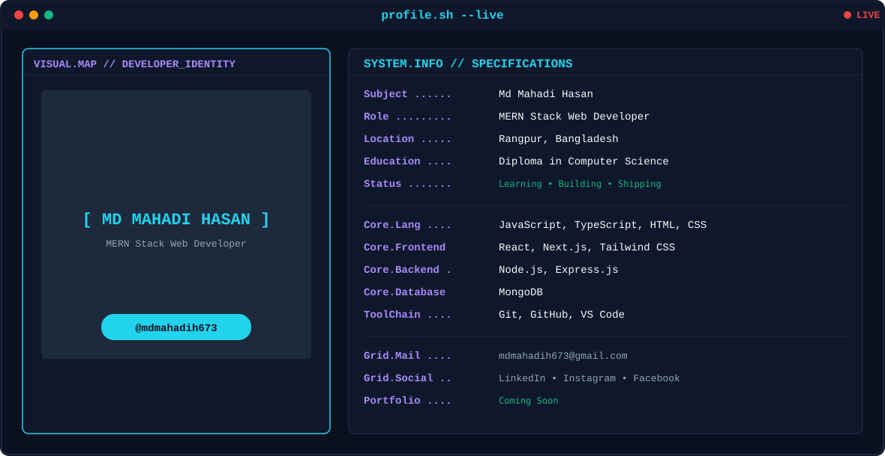

<!-- BANNER -->

  <picture>
    <source media="(prefers-color-scheme: dark)" srcset="dark.svg">
    <source media="(prefers-color-scheme: light)" srcset="light.svg">
    
  </picture>

<!-- TYPING INTRO -->

  

 

<!-- BADGES -->

  
  
  

 

  

<!-- TECH STACK -->
<h2 align="center">⚡ Tech Arsenal</h2>

  

 

  

<!-- STATS -->
<h2 align="center">📊 GitHub Stats</h2>

  
    
  
  

 

<!-- TROPHIES -->
<!--
  The public github-profile-trophy.vercel.app instance is often down, so this
  section is disabled for now to avoid a broken image.

  To enable it:
  1. Fork https://github.com/ryo-ma/github-profile-trophy
  2. Deploy the fork on Vercel (free)
  3. Replace YOUR-TROPHY-DOMAIN below with your deployment's domain
  4. Remove this comment wrapper (the opening and closing comment markers)

<h2 align="center">🏆 Trophies</h2>

  

 
-->

<!--

  

FEATURED PROJECTS: remove this comment wrapper and put your repo names below.

<h2 align="center">🚀 Featured Projects</h2>

  
  

-->

<!-- CONTRIBUTION SNAKE -->
<h2 align="center">🐍 Contribution Snake</h2>

  <picture>
    <source media="(prefers-color-scheme: dark)" srcset="https://raw.githubusercontent.com/mdmahadih673/mdmahadih673/output/github-snake-dark.svg" />
    <source media="(prefers-color-scheme: light)" srcset="https://raw.githubusercontent.com/mdmahadih673/mdmahadih673/output/github-snake.svg" />
    
  </picture>

 

  

<!-- QUOTE -->

  

 

<!-- CONNECT -->
<h2 align="center">🤝 Let's Connect</h2>

  
  &nbsp;
  
  &nbsp;
  
  &nbsp;
  

 

<!-- FOOTER -->

  

